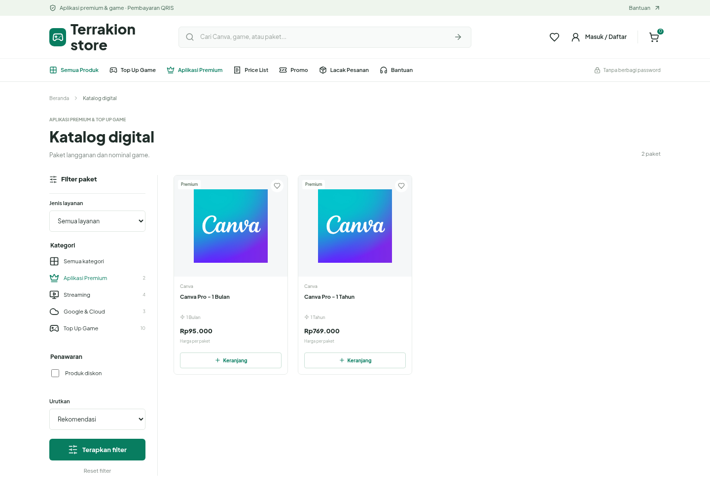
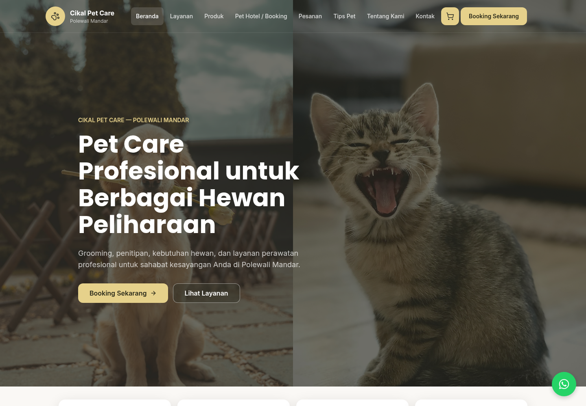

# Portfolio ALIEF RYANTO RAHMAN

Website portofolio pribadi ALIEF RYANTO RAHMAN, mahasiswa Teknik Informatika dan web developer. Website ini menampilkan profil, keahlian, pendidikan, pengalaman, organisasi, penghargaan, sertifikasi, serta proyek web yang telah dibuat berdasarkan CV.

## Fitur

- Halaman profil, pendidikan, keahlian, pengalaman, dan kontak
- Daftar proyek yang dimuat secara dinamis dari JSON
- Halaman khusus untuk seluruh proyek dan pengalaman
- Desain editorial gelap dengan tipografi serif, foto berlapis, dan aksen burgundy
- Pencarian dan filter kategori proyek, dengan status kosong dan tombol coba lagi
- Form kontak yang membuka draf pada aplikasi email, serta tombol salin alamat email
- Navigasi keyboard, menu seluler, dan dukungan `prefers-reduced-motion`
- Animasi masuk dan gerak foto halus yang responsif
- Tampilan yang mendukung desktop dan perangkat seluler

## Proyek

### Terrakion Store

Katalog aplikasi premium dan produk digital Terrakion Store, dengan pencarian, filter produk, keranjang belanja, dan pelacakan pesanan.

[Lihat Website](https://terrakionstore.my.id/index.php?page=catalog&category=aplikasi-premium)



### Cikal Pet Care Polman

Website pet care dan pet shop di Polewali Mandar menggunakan PHP, Tailwind CSS, dan Prisma. Dilengkapi reservasi layanan dan penitipan, validasi data pelanggan dan hewan, serta pengelolaan booking melalui dashboard admin dan API.

[Lihat Website](https://cikalpetcare.biz.id/)



### UMKM Kue Tradisional

Website UMKM toko kue tradisional dengan fitur dashboard penjual, daftar menu, informasi rekening, dan pengelolaan pesanan.

[Lihat Demo](https://kue-tradisional.vercel.app/) | [Kode Sumber](https://github.com/lifrmn/UMKM-Kue-Tradisional)


## Teknologi

- HTML5
- CSS3
- Vanilla JavaScript
- JSON
- Font Awesome
- Google Fonts: Bodoni Moda, DM Sans, Allura

Halaman utama, proyek, pengalaman, dan 404 berbagi tema di `assets/css/editorial.css` serta interaksi di `assets/js/editorial.js`. Data proyek dan keahlian berasal dari `projects/projects.json` dan `skills.json`. Foto asli di `assets/images/foto-saya.jpg` disimpan sebagai sumber untuk `portrait-cutout.png`.

Form kontak tidak mengirim email secara otomatis. Tombol **Open email draft** membuka aplikasi email pengguna dengan subjek dan isi yang sudah terisi; pengguna tetap perlu mengirim draf tersebut. Tautan email dan tombol salin alamat tersedia sebagai alternatif.

## Struktur Proyek

```text
.
├── index.html
├── 404.html
├── README.md
├── skills.json
├── assets/
│   ├── css/
│   │   └── editorial.css
│   ├── images/
│   │   ├── foto-saya.jpg
│   │   ├── grain.png
│   │   ├── portrait-cutout.png
│   │   └── projects/
│   └── js/
│       └── editorial.js
├── experience/
│   └── index.html
└── projects/
    ├── index.html
   └── projects.json
```

## Menjalankan Secara Lokal

Karena data keahlian dan proyek dimuat dengan `fetch`, jalankan website melalui server lokal, bukan langsung dari protokol `file://`.

1. Clone repository:

   ```bash
   git clone https://github.com/lifrmn/Lif_Portofolio.git
   cd Lif_Portofolio
   ```

2. Jalankan server lokal, misalnya dengan ekstensi Live Server di VS Code atau Python:

   ```bash
   python3 -m http.server 8000
   ```

3. Buka `http://localhost:8000` di browser.

## Menambah Proyek

1. Simpan gambar proyek di `assets/images/projects/`.
2. Tambahkan entri baru ke `projects/projects.json`, menggunakan entri yang sudah ada berikut sebagai acuan:

   ```json
   {
       "name": "UMKM Kue Tradisional",
       "desc": "A traditional cake shop website with a seller dashboard, cake menu, payment account details, and order management.",
       "image": "umkmkue-live.png",
       "category": "Web development",
     "links": {
          "view": "https://kue-tradisional.vercel.app",
          "code": "https://github.com/lifrmn/UMKM-Kue-Tradisional"
     }
   }
   ```

Gunakan nama file gambar lengkap beserta ekstensi. Nilai `category` langsung menjadi label pada kartu dan filter proyek; filter tampil jika ada lebih dari satu kategori. `links.code` bersifat opsional dan hanya diisi jika kode sumber tersedia untuk publik.

## Deployment

Website ini merupakan situs statis tanpa proses build. Unggah isi folder proyek ke hosting statis seperti GitHub Pages atau Vercel, dengan root proyek sebagai direktori publikasi.

## Kontak

- GitHub: [lifrmn](https://github.com/lifrmn)
- LinkedIn: [ALIEF RYANTO RAHMAN](https://www.linkedin.com/in/alief-ryanto-rahman-9706b3288/)
- CryptoJobsList: [terrakion_dev](https://cryptojobslist.com/@terrakion_dev)
- Email: [alif.iip456@gmail.com](mailto:alif.iip456@gmail.com)
- Telepon: [+62 822 9257 3528](tel:+6282292573528)
