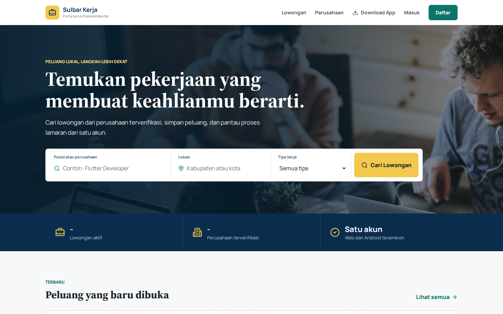

# Portfolio Alief Ryanto Rahman

Website portofolio pribadi Alief Ryanto Rahman, mahasiswa Teknik Informatika dan web developer. Website ini menampilkan profil, keahlian, pendidikan, pengalaman, serta proyek web yang telah dibuat.

## Fitur

- Halaman profil, pendidikan, keahlian, pengalaman, dan kontak
- Daftar proyek yang dimuat secara dinamis dari JSON
- Halaman khusus untuk seluruh proyek dan pengalaman
- Filter kategori proyek
- Mode terang dan gelap
- Animasi antarmuka yang responsif
- Tampilan yang mendukung desktop dan perangkat seluler

## Proyek

### Sulbar Kerja

Portal lowongan kerja lokal Polewali Mandar untuk mencari lowongan, menemukan perusahaan terverifikasi, menyimpan peluang, dan memantau proses lamaran.

[Lihat Demo](https://web-lime-nine-70.vercel.app/)



### UMKM Kue Tradisional

Website UMKM toko kue tradisional dengan fitur dashboard penjual, daftar menu, informasi rekening, dan pengelolaan pesanan.

[Lihat Demo](https://kue-tradisional.vercel.app/) | [Kode Sumber](https://github.com/lifrmn/UMKM-Kue-Tradisional)


### Cikal Pet Care Polewali Mandar

Website layanan grooming, penitipan, dan produk kucing di Polewali Mandar. Dilengkapi fitur booking, pesanan, serta tips kesehatan.

[Lihat Demo](https://website-kucing-polewali-mandar.vercel.app/) | [Kode Sumber](https://github.com/lifrmn/Website-Kucing-Polewali-Mandar)


## Teknologi

- HTML5
- CSS3
- JavaScript
- JSON
- jQuery
- AOS (Animate On Scroll)
- ScrollReveal
- Vanilla Tilt
- Isotope
- Typed.js
- Particles.js
- Font Awesome

## Struktur Proyek

```text
.
├── index.html
├── skills.json
├── netlify.toml
├── assets/
│   ├── css/
│   ├── images/
│   │   ├── educat/
│   │   └── projects/
│   └── js/
├── experience/
│   ├── index.html
│   ├── script.js
│   └── style.css
└── projects/
    ├── index.html
    ├── projects.json
    ├── script.js
    └── style.css
```

## Menjalankan Secara Lokal

Karena data keahlian dan proyek dimuat dengan `fetch`, jalankan website melalui server lokal, bukan langsung dari protokol `file://`.

1. Clone repository:

   ```bash
   git clone https://github.com/lifrmn/Lif_Portofolio.git
   cd Lif_Portofolio
   ```

2. Jalankan server lokal, misalnya dengan ekstensi Live Server di VS Code atau Python:

   ```bash
   python3 -m http.server 8000
   ```

3. Buka `http://localhost:8000` di browser.

## Menambah Proyek

1. Simpan gambar proyek di `assets/images/projects/`.
2. Tambahkan data proyek ke `projects/projects.json` dengan format berikut:

   ```json
   {
     "name": "Nama Proyek",
     "desc": "Deskripsi singkat proyek.",
     "image": "nama-gambar.png",
     "category": "basicweb",
     "links": {
       "view": "https://alamat-demo.example.com/",
       "code": "https://github.com/username/repository"
     }
   }
   ```

## Deployment

Website ini merupakan situs statis dan dapat di-deploy melalui Netlify, Vercel, atau GitHub Pages. Konfigurasi Netlify telah tersedia di `netlify.toml` dengan direktori publikasi pada root repository.

## Kontak

- GitHub: [lifrmn](https://github.com/lifrmn)
- LinkedIn: [Alief Ryanto Rahman](https://www.linkedin.com/in/alief-ryanto-rahman-9706b3288)
- Email: [alif.iip456@gmail.com](mailto:alif.iip456@gmail.com)
